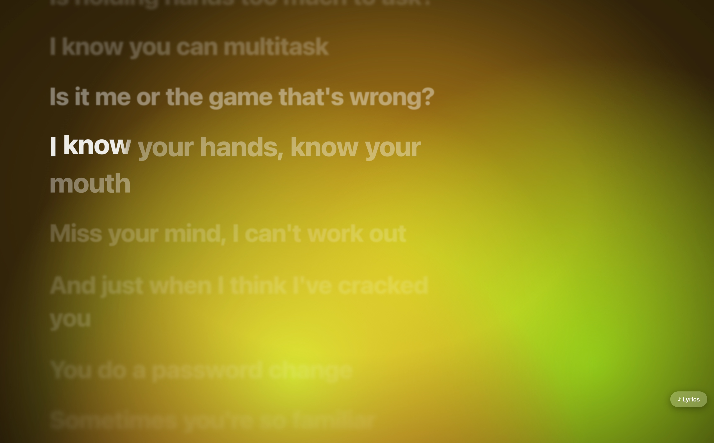
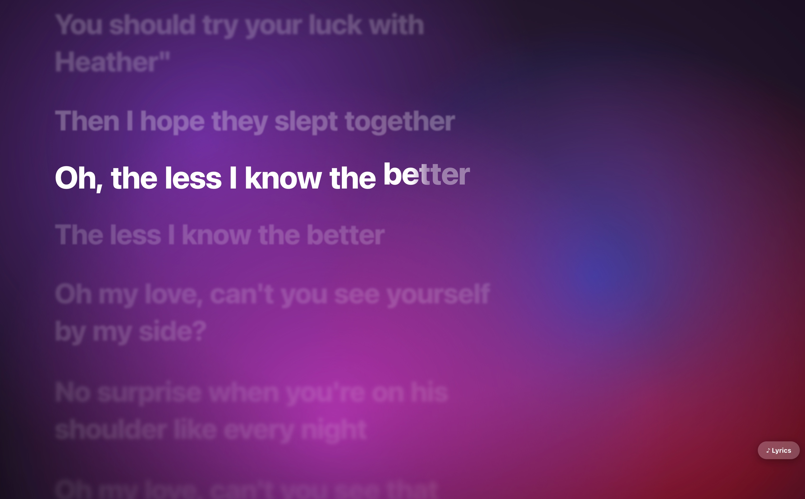

# Veloura for YouTube Music

Apple Music-style synced lyrics for **YouTube Music on the web**.

This is a personal project. I wanted a proper lyrics player like the one in Apple Music, and YouTube Music's web version doesn't have one, so I built it.

<!-- Add a screenshot or GIF:  -->

## Features

- Lyrics highlight **word by word** as they're sung
- Large, bold lyrics view with smooth scrolling, and blur and fade on lines you're not on
- Background colors and gentle motion that follow the **album art**
- Click any line to jump to it
- Works with lyrics in any language that has synced lyrics available
- Respects the system "reduce motion" setting, and has no flashing effects

###Screenshots





## Install

Download a build from the Releases page, or build it yourself (see below). Loading unpacked extensions means the browser may warn you the extension is unverified. That's expected for a project that isn't in an extension store.

### Firefox and Firefox-based browsers (Firefox, Zen, LibreWolf, Floorp, Waterfox)

1. Unzip `veloura-firefox.zip` into a folder.
2. Open `about:debugging#/runtime/this-firefox`.
3. Click **Load Temporary Add-on** and select `manifest.json` in the folder.
4. Open [music.youtube.com](https://music.youtube.com) and play a song.

Temporary add-ons are removed when the browser closes, so repeat the steps next session. A Permanent Install is not possible yet, maybe soon.

### Chrome, Edge, Brave, Opera, Vivaldi, Arc (Chromium-based)

1. Unzip `veloura-chrome.zip` into a folder.
2. Open the extensions page (`chrome://extensions`, `edge://extensions`, `brave://extensions` and so on).
3. Turn on **Developer mode**.
4. Click **Load unpacked** and select the folder.
5. Open [music.youtube.com](https://music.youtube.com) and play a song.

This install stays after restarts.

> **Tested:** the Firefox build in Zen. The Chromium build uses the same code with a Manifest V3 file, but hasn't been tested yet. Reports and fixes are welcome.
>
> **Not supported:** Safari (it needs conversion with Xcode) and mobile browsers.

## Usage

| Action | How |
| --- | --- |
| Open or close lyrics | Click **♪ Lyrics** (bottom right) or press **W** |
| Cover the whole screen | **Shift + W** |
| Go back or close | **Esc** |
| Jump to a line | Click it |

The keys avoid YouTube Music's own shortcuts (L, F, J, K and so on).

## How it works

- `src/content.js` runs on music.youtube.com. It reads the current song's title, artist and playback time, builds the lyrics view, and updates the highlighted word on every animation frame.
- `src/background.js` fetches synced lyrics from [LRCLIB](https://lrclib.net) and downloads the album cover so the page can read its colors.
- Lyrics use the LRC format (`[mm:ss.xx] text`). LRC only times whole lines, so each line's time is divided between its words by length.
- The cover is drawn on a tiny canvas, its most vivid colors are picked, and they drive the background gradients.
- `src/style.css` holds the layout and animations.

## Build from source

Requires `bash` and `zip`.

```bash
git clone https://github.com/SidhvizReddy/veloura.git
cd veloura
./build.sh
```

This creates `dist/firefox`, `dist/chrome` and a zip of each. Load those folders as described above.

## Limitations

- **Word timing is estimated.** The lyrics database only times whole lines, so words inside a line are spread evenly by length. Word-level accuracy would need a licensed provider.
- **Lyrics coverage depends on LRCLIB.** New or rare songs may show "No synced lyrics found", and a few songs may match a wrong version.
- YouTube Music's page can change and break the song lookup or cover detection.

## Privacy

Veloura has no analytics and no account. It makes these requests:

- To `lrclib.net`: the song title, artist and duration, to look up lyrics.
- To Google and YouTube image hosts: to download the current album cover, for color extraction.

The only thing stored is whether the lyrics view was left open (in the page's local storage). Lyrics are fetched on demand and not saved.

## Roadmap

- [ ] Word-level timing from a licensed lyrics source
- [ ] Android lock-screen version
- [ ] Optional beat-reactive background
- [ ] Settings page (font size, alignment, colors)
- [ ] Browser store listings

## Disclaimer

This is an independent, unofficial project. It is not affiliated with or endorsed by YouTube, Google or Apple. Lyrics belong to their respective owners and come from a third-party community database.

## Contributing

Issues and pull requests are welcome, especially bug reports for other browsers and songs where the lyrics or colors look wrong.

## License

[MIT](LICENSE)
